# NỘI DUNG HƯỚNG DẪN SỬ DỤNG CHO HỌC VIÊN
Bản chữ trích nguyên văn từ file Word trong `tai-lieu-nguon/`; hình trỏ tới `hinh/`.

**DÀNH CHO HỌC VIÊN & CƠ QUAN CHỨC NĂNG: TRA CỨU & XÁC THỰC BẰNG CẤP MINH BẠCH 24/7**

**Cổng tra cứu (daotao.vienstp.com)** giải quyết triệt để vấn đề chứng chỉ giả hoặc thất lạc bằng cấp

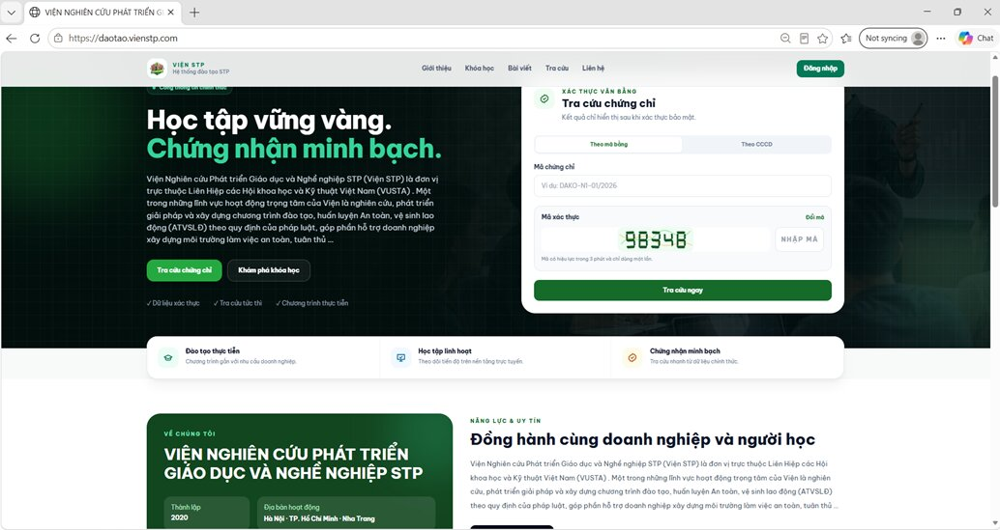

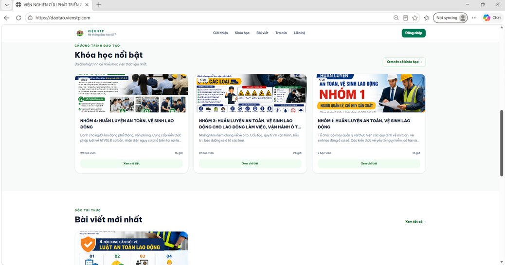

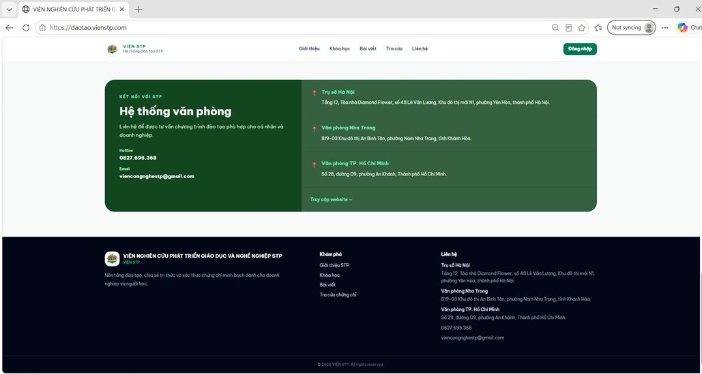

**Tổng quan các khu vực chính trên trang màn hình chính**

- **Thanh điều hướng (Header) ở đầu trang:**

  - **Logo & Tên Viện:** Nhấn vào để luôn quay về trang chủ.

  - **Menu chính:** Bao gồm các mục *Giới thiệu, Khóa học, Bài viết, Tra cứu, Liên hệ* giúp học viên dễ dàng chuyển hướng đến nội dung mong muốn.

  - **Nút "Đăng nhập":** Nằm ở góc trên bên phải, dùng để học viên truy cập vào tài khoản cá nhân của mình.

- **Khu vực Banner & Tra cứu chứng chỉ (Phần đầu):**

  - Hiển thị thông điệp chính: *"Học tập vững vàng. Chứng nhận minh bạch."*

  - Tích hợp sẵn bảng **Tra cứu chứng chỉ** (theo mã bằng hoặc theo CCCD) giúp học viên hoặc doanh nghiệp kiểm tra tính hợp pháp, minh bạch của chứng nhận nhanh chóng.

- **Khu vực Chương trình đào tạo nổi bật (Phần giữa):**

  - Trưng bày các khóa học trọng tâm, đặc biệt là các nhóm ngành huấn luyện an toàn, vệ sinh lao động (ATVSLD Nhóm 1, Nhóm 3, Nhóm 4...) kèm theo thông tin chi tiết về số lượng học viên và thời lượng.

  - Có nút **"Xem chi tiết"** hoặc **"Xem tất cả khóa học"** để học viên chọn lựa khóa học phù hợp với nhu cầu.

- **Khu vực Góc tri thức (Bài viết mới nhất):**

  - Cung cấp các kiến thức, cẩm nang và quy định pháp luật mới nhất liên quan đến nghề nghiệp và an toàn lao động.

- **Khu vực Hệ thống văn phòng & Chân trang (Footer):**

  - Cung cấp đầy đủ thông tin liên hệ, hotline, email và địa chỉ các trụ sở tại Hà Nội, Nha Trang, TP. Hồ Chí Minh để học viên dễ dàng nhận hỗ trợ trực tiếp.

**Hướng dẫn các thao tác dành cho học viên**

**Bước 1: Truy cập vào hệ thống**

- Mở trình duyệt web (Chrome, Edge, Safari,...) trên máy tính hoặc điện thoại.

- Nhập đường dẫn chính thức: **\[https://daotao.vienstp.com\](https://daotao.vienstp.com)** để vào màn hình chính.

**Bước 2: Đăng nhập tài khoản học viên**

- Nhìn lên góc trên bên phải màn hình, nhấp vào nút màu xanh **"Đăng nhập"**.

- Nhập thông tin tài khoản (tên đăng nhập/email và mật khẩu) được cấp để vào hệ thống quản lý học tập cá nhân, theo dõi tiến độ khóa học và nhận chứng chỉ.

**Bước 3: Tìm kiếm và đăng ký khóa học**

- Trên thanh menu, chọn mục **"Khóa học"** hoặc cuộn xuống phần **"Khóa học nổi bật"** ngay trang chủ.

- Tham khảo các chương trình đào tạo thực tiễn (ví dụ: Huấn luyện ATVSLD các nhóm).

- Nhấn vào **"Xem chi tiết"** của khóa học bạn quan tâm để đọc chương trình học, thời lượng và tiến hành đăng ký.

**Bước 4: Tra cứu chứng chỉ nhanh**

- Ngay tại phần banner đầu trang chủ, bạn có thể sử dụng ngay khung **"Tra cứu chứng chỉ"**.

- Chọn hình thức tra cứu (*Theo mã bằng* hoặc *Theo CCCD*), điền mã chứng chỉ/số CCCD và nhập mã xác thực hiển thị trên màn hình, sau đó bấm **"Tra cứu ngay"** để kiểm tra kết quả.

**Bước 5: Liên hệ hỗ trợ**

- Nếu cần tư vấn thêm về lộ trình học, hãy kéo xuống phần cuối trang để lấy thông tin Hotline (**0827.695.368**) hoặc gửi email về **viencongnghestp@gmail.com** để được giải đáp kịp thời.

**1. Trang tài khoản cá nhân** (**STP Learner Portal**) dành cho học viên được thiết kế trực quan, giúp người lao động dễ dàng theo dõi toàn bộ lộ trình học tập, quản lý bảo hộ lao động và tương tác công việc ngay trên một giao diện.

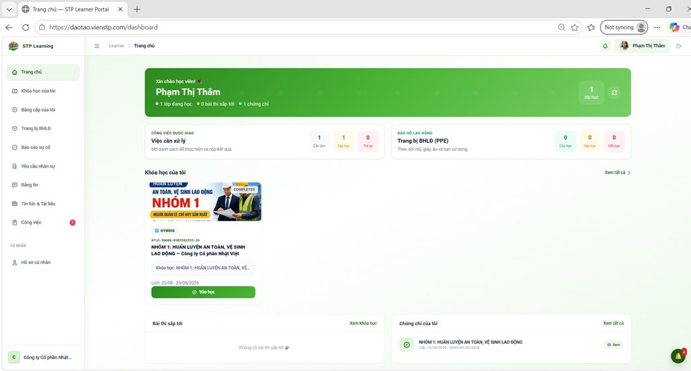

• **Menu điều hướng bên trái (Sidebar):** Quản lý toàn bộ các tab chức năng của học viên:

- **Chính:** *Trang chủ, Khóa học của tôi, Bằng cấp của tôi, Trang bị BHLD, Báo cáo sự cố, Yêu cầu nhân sự*.

- **Thông tin chung:** *Bảng tin, Tin tức & Tài liệu, Công việc*.

- **Cá nhân:** *Hồ sơ cá nhân*.

• **Khu vực chào mừng và Tổng quan tài khoản (Banner xanh lá):**

- Hiển thị lời chào và tên học viên kèm theo tóm tắt nhanh tình trạng học tập: **1 lớp đang học, 0 bài thi sắp tới, 1 chứng chỉ**.

• **Khu vực Thống kê nhanh:**

- **Công việc được giao (Việc cần xử lý):** Thống kê số lượng việc cần làm, đang xử lý, đã hoàn thành, bị trễ.

- **Trang bị BHLD (Bảo hộ lao động):** Theo dõi trạng thái đồ mùa, giày, do và hạn sử dụng các trang thiết bị bảo hộ được cấp.

• **Khu vực Khóa học của tôi:**

- Hiển thị các khóa học mà học viên đang tham gia (ví dụ: *Nhóm 1: Huấn luyện an toàn, vệ sinh lao động*).

- Cung cấp thông tin lịch học, mã lớp và nút **"Vào học"** màu xanh lá để truy cập trực tiếp vào bài giảng.

• **Khu vực Bài thi sắp tới & Chứng chỉ của tôi:**

- **Bài thi sắp tới:** Liệt kê các lịch kiểm tra, thi cử (nếu có).

- **Chứng chỉ của tôi:** Nơi lưu trữ các chứng nhận đã đạt được sau khi hoàn thành khóa học (ví dụ: chứng chỉ khóa huấn luyện An toàn, vệ sinh lao động nhóm 1) kèm nút **"Xem"**.

### Quản lý khóa học và xem văn bằng

- **Xem danh sách khóa học:** Nhấp vào mục **"Khóa học của tôi"** trên menu bên trái để xem toàn bộ các lớp học bạn đã và đang tham gia.

- **Kiểm tra chứng chỉ/bằng cấp:** Nhấp vào mục **"Bằng cấp của tôi"** ở menu bên trái (hoặc nhìn vào khung *Chứng chỉ của tôi* ở góc dưới bên phải) để xem, kiểm tra hoặc tải về các chứng nhận đã đạt được.

> **  
> **

**  
**

2\. Trang thiết bị: Giúp quản lý trang bị được cấp phát, báo hỏng/mất và gửi yêu cầu cấp mới tới doanh nghiệp

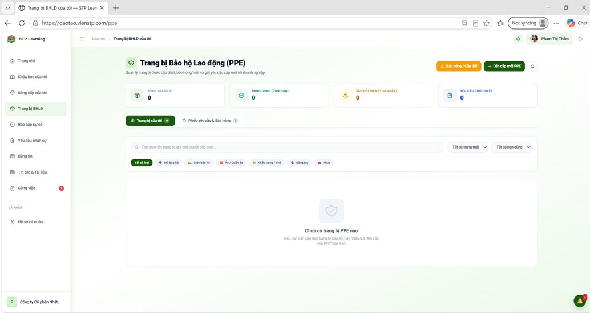

- **Khu vực Thống kê trạng thái (4 thẻ tổng quan):**

  - **Tổng trang bị:** 0.

  - **Đang dùng (Còn hạn):** 0.

  - **Sắp hết hạn (\$\le\$ 30 ngày):** 0.

  - **Yêu cầu chờ duyệt:** 0.

- **Tab điều hướng nội dung bên dưới:**

  - Tab **"Trang bị của tôi"**: Hiển thị danh sách thiết bị đang quản lý.

  - Tab **"Phiếu yêu cầu & Báo hỏng"**: Theo dõi các trạng thái đơn từ bạn đã gửi.

- **Bộ lọc và Tìm kiếm:**

  - Thanh tìm kiếm theo tên trang bị, ghi chú, người cấp phát.

  - Các bộ lọc theo loại trang bị (*Tất cả loại, Mũ bảo hộ, Giày bảo hộ, Áo / Quần áo, Khẩu trang / Thơ, Găng tay, Khác*) và bộ lọc trạng thái, hạn dùng.

- **Khu vực hiển thị danh sách:**

  - Hiện tại hiển thị thông báo: *"Chưa có trang bị PPE nào. Nếu bạn cần cấp mới trang bị bảo hộ, hãy nhấn nút 'Xin cấp mới PPE' bên trên."*

**Hướng dẫn các thao tác cho học viên / người lao động**

**Bước 1: Truy cập trang quản lý bảo hộ**

- Từ menu bên trái màn hình học viên, nhấp chọn mục **"Trang bị BHLD"** để mở giao diện quản lý trang thiết bị bảo hộ lao động cá nhân.

**Bước 2: Xin cấp mới trang thiết bị PPE**

1.  Nhìn lên góc trên bên phải màn hình và bấm vào nút **"+ Xin cấp mới PPE"** (màu xanh lá).

2.  Điền đầy đủ thông tin trang thiết bị cần cấp phát theo biểu mẫu xuất hiện trên hệ thống.

3.  Gửi yêu cầu và chờ doanh nghiệp phê duyệt.

**Bước 3: Báo hỏng hoặc yêu cầu cấp đổi**

1.  Nếu trang thiết bị cũ bị hư hỏng hoặc cần thay đổi, hãy nhấn vào nút **"Báo hỏng / Cấp đổi"** (màu vàng) ở góc trên bên phải.

2.  Chọn loại trang bị cần báo hỏng/cấp đổi, nhập lý do cụ thể và gửi phiếu yêu cầu.

**Bước 4: Theo dõi tiến độ duyệt phiếu**

- Sau khi gửi yêu cầu, bạn có thể bấm sang tab **"Phiếu yêu cầu & Báo hỏng"** để kiểm tra xem đơn của mình đang ở trạng thái *chờ duyệt, đã duyệt* hay *từ chối*.

> **3. Báo cáo sự cố:** Chủ động báo cáo nguy cơ, sự cố hoặc tai nạn tới doanh nghiệp.

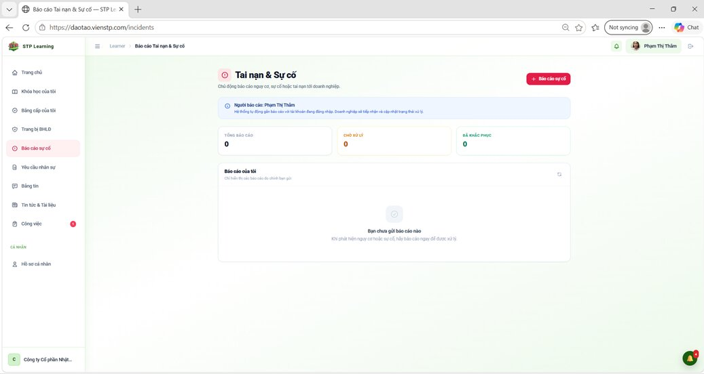

- **Khu vực Thống kê trạng thái (3 thẻ tổng quan):**

  - **Tổng báo cáo:** 0.

  - **Chờ xử lý:** 0.

  - **Đã khắc phục:** 0.

- **Danh sách "Báo cáo của tôi":**

  - Nơi lưu trữ lịch sử các sự cố mà bạn đã gửi.

  - Hiện tại hiển thị thông báo: *"Bạn chưa gửi báo cáo nào. Khi phát hiện nguy cơ hoặc sự cố, hãy báo cáo ngay để được xử lý"*.

**Hướng dẫn cách tạo và gửi báo cáo sự cố**

**Bước 1: Truy cập trang quản lý sự cố**

- Từ thanh menu điều hướng ở cạnh trái màn hình, nhấn chọn mục **"Báo cáo sự cố"** để mở giao diện quản lý này.

**Bước 2: Thực hiện báo cáo sự cố mới**

1.  Nhìn lên góc trên bên phải màn hình và nhấn vào nút đỏ **"+ Báo cáo sự cố"**.

2.  Điền đầy đủ các thông tin chi tiết về sự cố, mối nguy hiểm hoặc tai nạn vừa phát sinh theo biểu mẫu yêu cầu trên màn hình.

3.  Nhấn gửi biểu mẫu để hệ thống ghi nhận.

**Bước 3: Theo dõi tiến độ xử lý**

- Sau khi gửi thành công, báo cáo của bạn sẽ xuất hiện trong danh sách dưới mục **"Báo cáo của tôi"**.

- Bạn có thể theo dõi sự thay đổi trạng thái từ **"Chờ xử lý"** sang **"Đã khắc phục"** để biết được doanh nghiệp đã tiếp nhận và giải quyết vấn đề hay chưa.

4\. Yêu cầu nhân sự

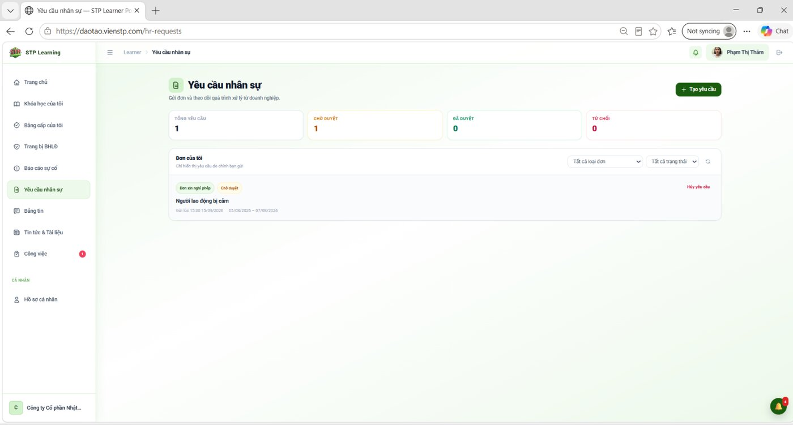

**Mục đích:** Là nơi để nhân sự gửi các loại đơn từ, biểu mẫu hành chính (như đơn xin nghỉ phép, xin trợ cấp, xét lương, nghỉ việc, công tác...) tới bộ phận nhân sự hoặc quản lý, đồng thời theo dõi tiến trình xử lý các yêu cầu đó của doanh nghiệp.

### Các chỉ số thống kê tổng quan (Dashboard Widgets)

Giao diện cung cấp bảng tổng hợp số lượng đơn từ theo các trạng thái xử lý:

- **Tổng yêu cầu:** 1 (Tổng số đơn cá nhân đã gửi).

- **Chờ duyệt:** 1 (Số đơn đang chờ cấp trên hoặc bộ phận nhân sự phê duyệt).

- **Đã duyệt:** 0 (Số đơn đã được thông qua).

- **Từ chối:** 0 (Số đơn không được chấp thuận).

### Khu vực quản lý "Đơn của tôi" và Bộ lọc

- **Danh sách hiển thị:** Liệt kê chi tiết các đơn đã gửi gồm: Loại đơn (*Đơn xin nghỉ phép*), Trạng thái (*Chờ duyệt*), Tiêu đề nội dung (*Người lao động bị cấm*), và mốc thời gian gửi/thời gian diễn ra sự việc.

- **Bộ lọc tìm kiếm:** Hỗ trợ lọc danh sách theo *Tất cả loại đơn* và *Tất cả trạng thái* giúp người dùng dễ dàng tra cứu lại lịch sử nộp đơn.

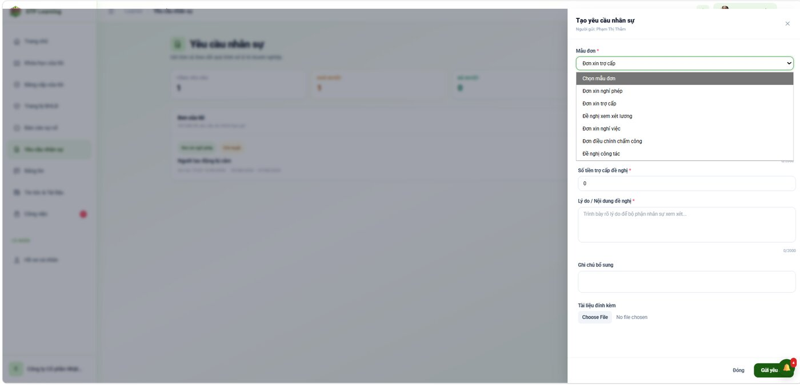

Khi người dùng bấm vào nút **"+ Tạo yêu cầu"**, một bảng trượt bên phải xuất hiện với các bước lập đơn như sau:

**Chọn mẫu đơn (*Mẫu đơn*):** Hệ thống cung cấp sẵn nhiều biểu mẫu phong phú cho nhân sự lựa chọn:

- *Đơn xin nghỉ phép*

- *Đơn xin trợ cấp*

- *Đề nghị xem xét lương*

- *Đơn xin nghỉ việc*

- *Đơn điều chỉnh chấm công*

- *Đề nghị công tác*

**Điền thông tin chi tiết:** Tùy thuộc vào loại mẫu đơn được chọn, giao diện sẽ thay đổi các trường dữ liệu tương ứng (Ví dụ: với *Đơn xin trợ cấp* sẽ có thêm trường nhập số tiền đề nghị).

**Lý do / Nội dung đề nghị:** Trình bày rõ ràng lý do để bộ phận nhân sự có cơ sở xem xét.

**Ghi chú bổ sung & Tài liệu đính kèm:**

- Nhập thêm thông tin phụ (nếu cần).

- Sử dụng nút **"Choose File"** để đính kèm các chứng từ, file minh chứng liên quan.

**Gửi yêu cầu:** Kiểm tra lại thông tin và bấm nút **"Gửi yêu"** màu xanh ở góc dưới bên phải để hoàn tất quy trình tạo đơn. Sau đó đơn của nhân viên sẽ được gửi đến module “Công tác & công việc -\> Quản lý đơn từ” của doanh nghiệp để cho lãnh đạo duyệt.

5\. Tin tức & tài liệu

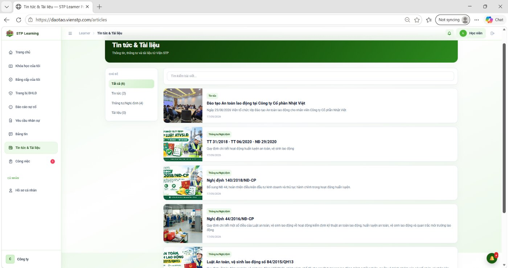

Là cổng thông tin nội bộ của **Viện STP**, cung cấp các thông tin, thông tư, nghị định và tài liệu chính thống cho học viên/nhân sự.

Hệ thống phân loại nội dung thành các nhóm rõ ràng kèm theo số lượng bài viết tương ứng

Có ô nhập nội dung **"Tìm kiếm bài viết..."** ở phía trên danh sách, giúp người dùng tra cứu nhanh chóng theo từ khóa.

Trang hiển thị danh sách các bài viết trực quan với hình ảnh minh họa, nhãn phân loại, tiêu đề, tóm tắt và ngày đăng

6\. Công việc

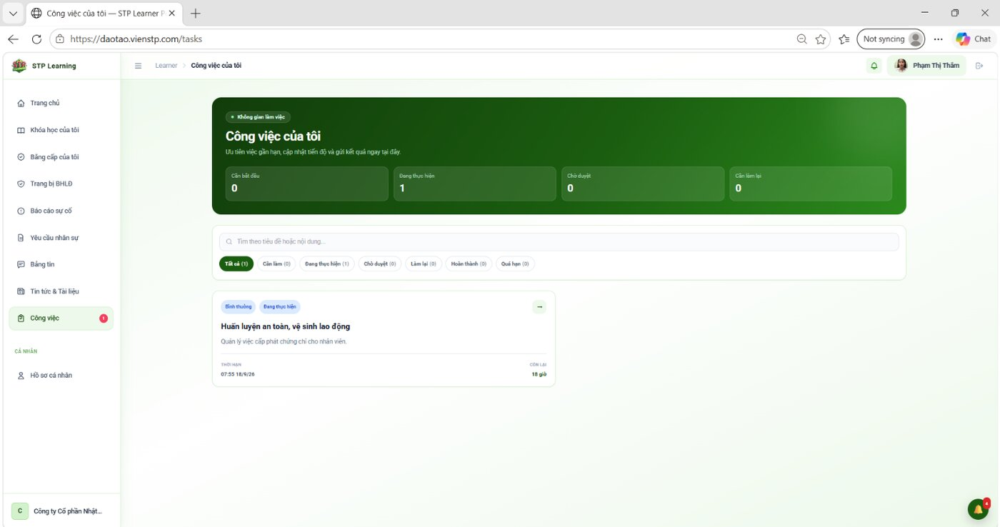

Là không gian cá nhân để người dùng (nhân viên/học viên) theo dõi các nhiệm vụ được phân công, cập nhật tiến độ thực hiện và gửi kết quả công việc ngay trên hệ thống.

### Các chỉ số thống kê tổng quan 

Giao diện cung cấp các thẻ tổng hợp trạng thái công việc cá nhân giúp người dùng dễ dàng kiểm soát khối lượng công việc:

- **Cần bắt đầu:** 0 (Số lượng công việc mới được giao nhưng chưa bắt đầu).

- **Đang thực hiện:** 1 (Số lượng công việc đang trong quá trình triển khai).

- **Chờ duyệt:** 0 (Công việc đã hoàn thành và đang chờ cấp trên nghiệm thu).

- **Cần làm lại:** 0 (Công việc bị từ chối kết quả và yêu cầu chỉnh sửa).

### Công cụ tìm kiếm và Bộ lọc trạng thái

- **Ô tìm kiếm tự do:** Nhập từ khóa để tìm nhanh *"Tìm theo tiêu đề hoặc nội dung..."*.

- **Các thẻ lọc trạng thái chi tiết:**

  - *Tất cả (1)*

  - *Cần làm (0)*

  - *Đang thực hiện (1)*

  - *Chờ duyệt (0)*

  - *Làm lại (0)*

  - *Hoàn thành (0)*

  - *Quá hạn (0)*

### Danh sách công việc cá nhân chi tiết

- **Nhiệm vụ mẫu hiển thị:** Công việc **"Huấn luyện an toàn, vệ sinh lao động"** (Mô tả: *"Quản lý việc cấp phát chứng chỉ cho nhân viên"*).

- **Thông tin chi tiết trên thẻ công việc:**

  - *Mức độ ưu tiên & Trạng thái:* Bình thường - Đang thực hiện.

  - *Thời hạn (Deadline):* 07:55 18/9/26.

  - *Thời gian còn lại:* Hiển thị trực quan thời gian đếm ngược

7\. Hồ sơ cá nhân

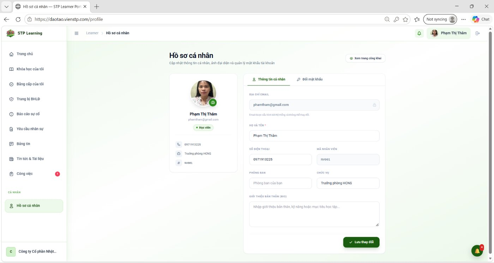

Là không gian để người dùng cập nhật thông tin cá nhân, ảnh đại diện, thay đổi mật khẩu và quản lý thông tin tài khoản của mình.

Khu vực Thẻ thông tin cá nhân

- Hiển thị ảnh đại diện, họ tên (**Phạm Thị Thâm**), email, vai trò (*Học viên*), số điện thoại, chức vụ (*Trưởng phòng HCNS*) và mã nhân viên (NV001).

###  Khu vực chỉnh sửa thông tin (Bên phải)

Giao diện cung cấp hai tab chính để quản lý tài khoản:

- **Tab 1: Thông tin cá nhân** (đang chọn):

  - Cho phép chỉnh sửa các trường thông tin: *Địa chỉ email*, *Họ và tên*, *Số điện thoại*, *Mã nhân viên*, *Phòng ban*, *Chức vụ* và phần *Giới thiệu bản thân (Bio)* để nhập kỹ năng hoặc mục tiêu học tập.

  - Có nút **"Lưu thay đổi"** màu xanh lá ở góc dưới để cập nhật thông tin.

- **Tab 2: Đổi mật khẩu:**

  - Dùng để quản lý và cập nhật mật khẩu bảo mật cho tài khoản cá nhân.
