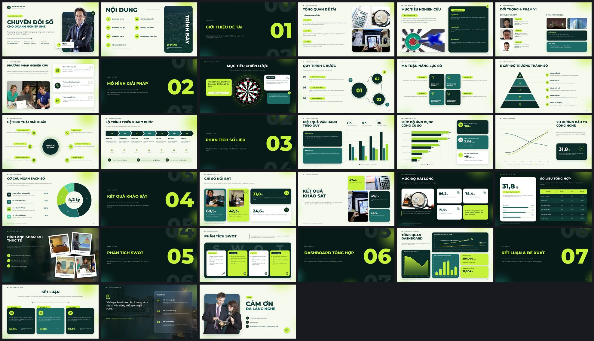
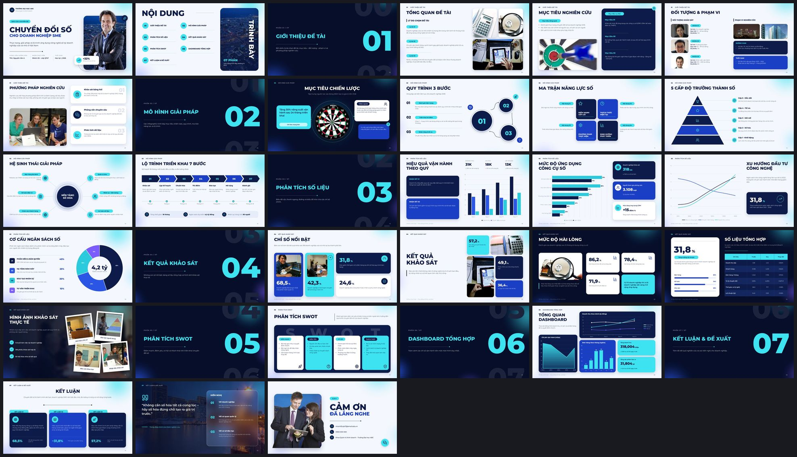
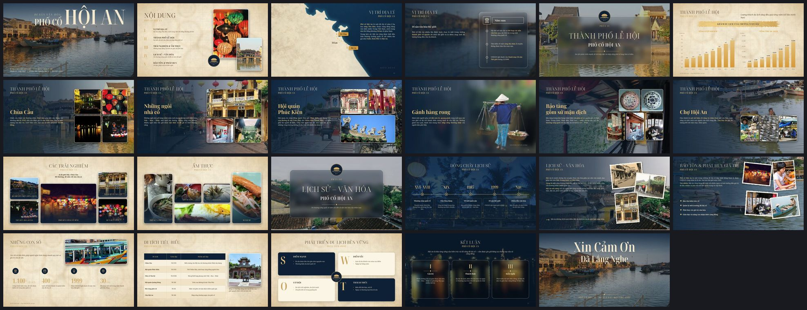
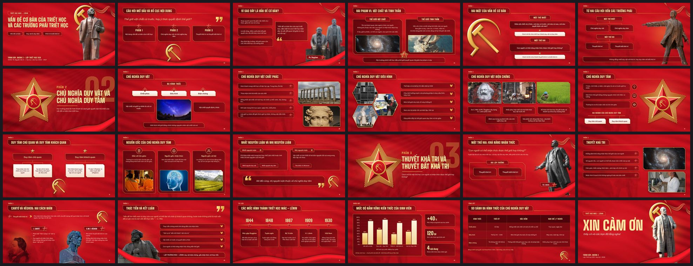
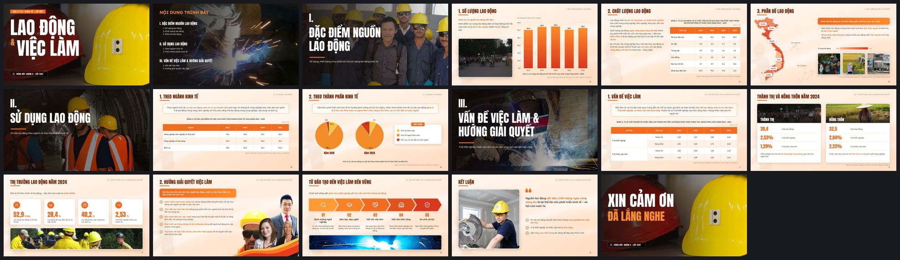
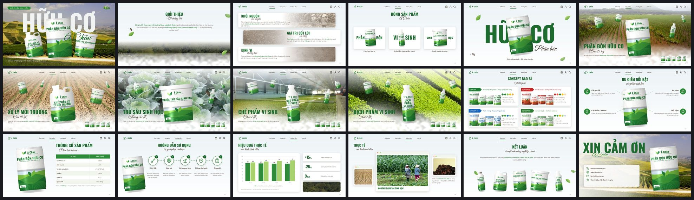
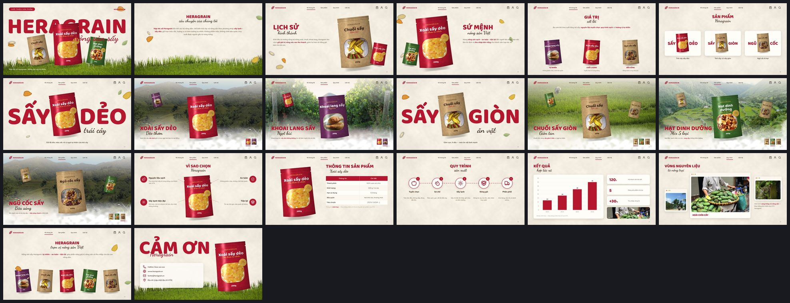
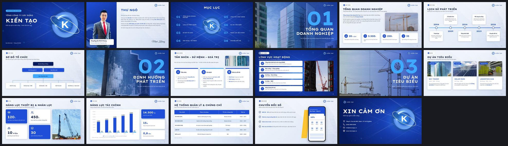
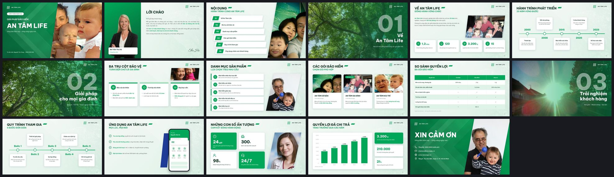
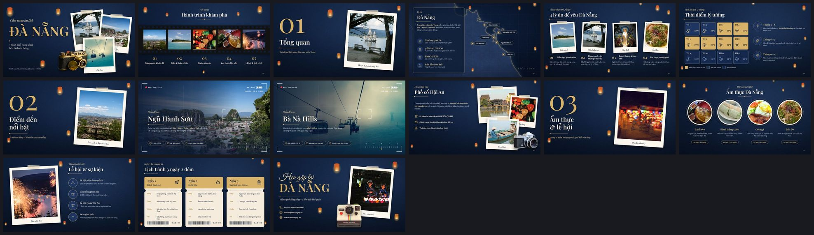

# Kho Mẫu Slide DAKO

Danh sách mẫu slide. Trang thư viện có ảnh xem trước: [https://claude.ai/artifact/JmoetKFXwLHYifaeGuBUih](https://claude.ai/artifact/JmoetKFXwLHYifaeGuBUih)

**Cách gọi mẫu:** trong phiên Claude Code của kho này, gõ câu gọi bên dưới và đính kèm tài liệu (Word, PDF, PowerPoint, ghi chú…). Claude sẽ dàn nội dung vào mẫu và trả về file `.pptx` có hiệu ứng.

| Mã | Tên mẫu | Phong cách | Phù hợp cho | Trạng thái |
|---|---|---|---|---|
| **M01** | Báo cáo Xanh Lime | Báo cáo đề tài hiện đại: rêu đậm + xanh lime, nhân vật tách nền bật khỏi khung ảnh. | Báo cáo môn học, tiểu luận, khóa luận; Báo cáo nghiên cứu có khảo sát, số liệu; Đề án, kế hoạch, báo cáo dự án | 33 slide |
| **M02** | Báo cáo Aurora | Cùng bố cục với M01, tông xanh navy + aqua – hợp báo cáo công nghệ, doanh nghiệp. | Báo cáo công nghệ, chuyển đổi số; Báo cáo kinh doanh, kết quả quý / năm; Thuyết trình dự án cho doanh nghiệp | 33 slide |
| **M03** | Di sản Hội An | Cổ điển, điện ảnh: ảnh tràn nền phủ tối, chữ có chân mảnh, giấy cổ, ảnh polaroid mép rách. | Văn hóa, lịch sử, di sản, địa danh; Du lịch, ẩm thực, giới thiệu địa phương; Báo cáo môn Văn hóa Việt Nam, Lịch sử, Địa lý | 23 slide |
| **M04** | Chính luận Mác – Lênin | Lụa đỏ, vàng kim, búa liềm và huân chương sao; tượng tách nền làm người dẫn chuyện, chữ áp phích khổ hẹp. | Triết học, Kinh tế chính trị, CNXH khoa học Mác – Lênin; Tư tưởng Hồ Chí Minh, Lịch sử Đảng CSVN; Thuyết trình chính trị – xã hội, sinh hoạt Đoàn – Đảng | 24 slide |
| **M05** | Lao động – Việc làm | Ảnh công nhân, tia hàn điện ảnh; trang giấy kem – cam với biểu đồ cột cam, bảng, biểu đồ tròn, bản đồ 6 vùng. | Địa lí 12: lao động, việc làm, dân cư, các ngành kinh tế; Báo cáo kinh tế – xã hội, thị trường lao động, nhân sự; An toàn lao động, đào tạo nghề, giới thiệu ngành nghề | 17 slide |
| **M06** | Sản phẩm Thiên nhiên | Trắng – xanh thiên nhiên kiểu website: chữ khổ hẹp + chữ viết tay, băng chuyền sản phẩm, so sánh 4 concept bao bì. Demo: Á Châu. | Giới thiệu sản phẩm nông nghiệp, phân bón, thực phẩm, đồ uống; Ra mắt dòng sản phẩm, catalogue bán hàng; Hồ sơ năng lực sản phẩm cho đối tác, nhà phân phối | 18 slide |
| **M07** | Nông sản Đặc sản | Giấy kem ấm, chữ bo tròn + chữ viết tay, sản phẩm giữa chữ khổng lồ, đồng ruộng phủ sương. Demo: Heragrain Foods (cửa sổ chữ H). | Giới thiệu nông sản, đặc sản, sản phẩm OCOP, đồ sấy; Cà phê, trà, bánh, đồ uống, F&B; Hợp tác xã, cơ sở sản xuất giới thiệu sản phẩm | 19 slide |
| **M08** | Hồ sơ Doanh nghiệp | Xanh hoàng gia, biểu tượng vòng sáng 3D, chữ rộng Lexend Exa, nhãn phần dạng viên thuốc, số chương viền sáng. Demo: tổng công ty xây dựng giả định "Kiến Tạo". | Hồ sơ năng lực, giới thiệu công ty; Đấu thầu, chào hàng B2B; Báo cáo thường niên, đại hội cổ đông | 17 slide |
| **M09** | Giới thiệu Dịch vụ | Xanh lá tươi, vạch xiên, ảnh khung hình bình hành, tiêu đề hai tầng. Demo: dịch vụ bảo hiểm giả định "An Tâm Life". | Giới thiệu dịch vụ, gói sản phẩm, bảng giá; Bảo hiểm, ngân hàng, y tế, giáo dục; Tư vấn khách hàng, hội thảo bán hàng | 17 slide |
| **M10** | Du lịch Đà Nẵng | Nền giấy xanh đêm, chữ vàng Playfair, đèn trời bay qua các slide, ảnh polaroid dán băng keo, máy ảnh cổ, khung ngắm máy quay, cuộn phim, lịch 12 tháng, vé lịch trình. | Giới thiệu điểm đến, thành phố, tour du lịch; Cẩm nang du lịch, lịch trình, ẩm thực địa phương; Bài thuyết trình địa lí – văn hóa vùng miền | 15 slide |

## M01 · Báo cáo Xanh Lime

Báo cáo đề tài hiện đại: rêu đậm + xanh lime, nhân vật tách nền bật khỏi khung ảnh.

- **Câu gọi:** `Dùng mẫu M01 · Báo cáo Xanh Lime để làm bộ slide từ tài liệu tôi gửi kèm.`
- **Gọi tắt:** xanh lime, lime, báo cáo xanh, mẫu báo cáo xanh lime, báo cáo sinh viên, video 1
- **Bảng màu:** `#0B2C28` Rêu đậm, `#1D6B67` Xanh rêu, `#C6F23A` Lime, `#F6FAEE` Nền sáng, `#071A17` Nền tối
- **Font:** Montserrat
- **File mẫu:** `slides-template/output/Mau-Bao-Cao-Lime.pptx` (7.4 MB)
- **Dựng:** `python build_deck.py --theme lime --content <file.json> --name <Ten-file>` — nội dung mẫu: `catalog/samples/M01-M02-baocao.json`
- **Lấy cảm hứng từ:** Video 1 – mẫu báo cáo xanh lime (TikTok)
- **Các dạng slide** (`"slide"` trong file nội dung): `cover` Bìa – người tách nền bật khỏi khung ảnh, `agenda` Mục lục 7 phần, `section` Chuyển phần số lớn, `overview` Tổng quan + khảm 3 ảnh, `objectives` Mục tiêu tổng quát / cụ thể, `subjects` Đối tượng & phạm vi, `methods` Phương pháp (3 thẻ icon), `target` Bảng phi tiêu – mục tiêu chiến lược, `cycle` Chu trình 3 bước, `blocks4` Ma trận 2×2, `pyramid` Kim tự tháp 5 cấp, `hub` Trung tâm + 6 vệ tinh, `process` Lộ trình chevron 7 bước, `chart_columns` Biểu đồ cột + KPI, `chart_bars` Biểu đồ thanh ngang, `chart_lines` Biểu đồ đường, `chart_donut` Biểu đồ tròn, `stats4` 4 chỉ số có ảnh, `stats_mosaic` Khảm số liệu, `stats_dark` Chỉ số nền tối, `table_slide` Bảng số liệu + thanh tiến độ, `gallery` Ảnh polaroid trên nền mờ, `swot` SWOT, `dashboard` Dashboard 3 biểu đồ, `conclusion` Kết luận 3 thẻ, `proposal` Kiến nghị – thẻ kính mờ, `thanks` Cảm ơn

## M02 · Báo cáo Aurora

Cùng bố cục với M01, tông xanh navy + aqua – hợp báo cáo công nghệ, doanh nghiệp.

- **Câu gọi:** `Dùng mẫu M02 · Báo cáo Aurora để làm bộ slide từ tài liệu tôi gửi kèm.`
- **Gọi tắt:** aurora, xanh navy, báo cáo xanh dương, navy aqua, biến thể của M01
- **Bảng màu:** `#0C1B49` Navy, `#1B3FC4` Xanh hoàng gia, `#3DE3F0` Aqua, `#F4F7FE` Nền sáng, `#060E2A` Nền tối
- **Font:** Montserrat
- **File mẫu:** `slides-template/output/Mau-Bao-Cao-Aurora.pptx` (7.5 MB)
- **Dựng:** `python build_deck.py --theme aurora --content <file.json> --name <Ten-file>` — nội dung mẫu: `catalog/samples/M01-M02-baocao.json`
- **Lấy cảm hứng từ:** Biến thể màu của M01 (cùng bố cục)
- **Các dạng slide:** giống M01

## M03 · Di sản Hội An

Cổ điển, điện ảnh: ảnh tràn nền phủ tối, chữ có chân mảnh, giấy cổ, ảnh polaroid mép rách.

- **Câu gọi:** `Dùng mẫu M03 · Di sản Hội An để làm bộ slide từ tài liệu tôi gửi kèm.`
- **Gọi tắt:** hội an, hoi an, di sản, phố cổ, văn hóa, du lịch, cổ điển, video 2
- **Bảng màu:** `#0D2136` Navy đêm, `#C9A15B` Vàng kim, `#E2BF7A` Vàng nhạt, `#F3EAD4` Giấy cổ, `#3D2B1B` Nâu mực
- **Font:** Noto Serif Display · Noto Serif · Playfair Display
- **File mẫu:** `slides-template/output/Mau-Bao-Cao-HoiAn.pptx` (20.3 MB)
- **Dựng:** `python build_hoian.py --content <file.json> --name <Ten-file>` — nội dung mẫu: `catalog/samples/M03-hoian.json`
- **Lấy cảm hứng từ:** Video 2 – mẫu Phố cổ Hội An (TikTok)
- **Các dạng slide** (`"slide"` trong file nội dung): `cover` Bìa chữ lớn trên ảnh, `agenda` Mục lục số La Mã trên giấy cổ, `map_slide` Bản đồ + tuyến đường (tools/make_map.py), `glass_timeline` Thẻ kính mờ có mốc thời gian, `section` Chuyển phần – thẻ kính + huy hiệu, `charts` 2 biểu đồ cột vàng + dải cọ, `place` Địa danh + khảm 3–5 ảnh, `place_cutout` Nhân vật / đồ vật tách nền, `mosaic` Khảm ảnh có chú thích (trải nghiệm, ẩm thực), `timeline` Dòng thời gian 5 mốc, `polaroids` Ảnh polaroid mép rách + nội dung, `numbers` Những con số, `table_slide` Bảng trên giấy cổ, `swot` SWOT, `conclusion` Kết luận – 3 thẻ kính, `thanks` Cảm ơn

## M04 · Chính luận Mác – Lênin

Lụa đỏ, vàng kim, búa liềm và huân chương sao; tượng tách nền làm người dẫn chuyện, chữ áp phích khổ hẹp.

- **Câu gọi:** `Dùng mẫu M04 · Chính luận Mác – Lênin để làm bộ slide từ tài liệu tôi gửi kèm.`
- **Gọi tắt:** mác lênin, mac lenin, chính luận, chính trị, lý luận chính trị, triết học, đỏ vàng, video 3
- **Bảng màu:** `#C3141F` Đỏ son, `#7A0912` Đỏ thẫm, `#E3AE4A` Vàng kim, `#FFE6A1` Vàng nhạt, `#FFF4E2` Kem
- **Font:** Big Shoulders Display · Be Vietnam Pro
- **File mẫu:** `slides-template/output/Mau-Chinh-Luan-MacLenin.pptx` (13.9 MB)
- **Dựng:** `python build_maclenin.py --content <file.json> --name <Ten-file>` — nội dung mẫu: `catalog/samples/M04-maclenin.json`
- **Lấy cảm hứng từ:** Video 3 – mẫu Triết học Mác – Lênin (TikTok)
- **Các dạng slide** (`"slide"` trong file nội dung): `cover` Bìa – tượng tách nền, búa liềm, lụa đỏ, `agenda` Câu hỏi mở đầu + các phần, `quote_portrait` Trích dẫn + chân dung + 3 ý, `compare` So sánh 2 cột có ảnh, `aspects` Hai mặt + búa liềm lớn, `tree` Sơ đồ cây + chân dung, `section` Chuyển phần – huân chương sao, `forms3` Ba hình thức đánh số + ảnh, `star_list` Danh sách sao + 2 ảnh vát góc, `hex_list` Ảnh lục giác + danh sách, `strip` Dải 3 ảnh + thẻ chú thích, `medal_list` Danh sách icon + huân chương, `branches2` Hai nhánh khái niệm, `columns3` 3 cột icon + ảnh, `compare_quote` 2 thẻ khái niệm + câu kết, `question_portrait` Câu hỏi + hai lập trường + chân dung, `people` Hai nhân vật (tượng / tranh khắc), `conclusion` Kết luận + trích dẫn + chân dung, `timeline` Dòng thời gian 5 mốc, `chart` Biểu đồ cột vàng + 3 chỉ số, `table_slide` Bảng so sánh, `thanks` Cảm ơn

## M05 · Lao động – Việc làm

Ảnh công nhân, tia hàn điện ảnh; trang giấy kem – cam với biểu đồ cột cam, bảng, biểu đồ tròn, bản đồ 6 vùng.

- **Câu gọi:** `Dùng mẫu M05 · Lao động – Việc làm để làm bộ slide từ tài liệu tôi gửi kèm.`
- **Gọi tắt:** lao động, việc làm, lao động việc làm, kinh tế xã hội, địa lí, dân số, cam, video 4
- **Bảng màu:** `#F26B1F` Cam, `#D9381E` Đỏ cam, `#F8C43A` Vàng, `#FFF4EA` Kem, `#7A2A10` Nâu tiêu đề
- **Font:** Anton · Lexend
- **File mẫu:** `slides-template/output/Mau-Lao-Dong-Viec-Lam.pptx` (7.8 MB)
- **Dựng:** `python build_laodong.py --content <file.json> --name <Ten-file>` — nội dung mẫu: `catalog/samples/M05-laodong.json`
- **Lấy cảm hứng từ:** Video 4 – mẫu Lao động việc làm (TikTok)
- **Các dạng slide** (`"slide"` trong file nội dung): `cover` Bìa ảnh tràn – chữ lớn có dấu &, `agenda` Nội dung trình bày (I, II, III + mục con), `section` Chuyển phần ảnh tràn, `chart_text` Đoạn dẫn + ảnh + biểu đồ cột cam, `table_text` Gạch đầu dòng + bảng số liệu, `map_regions` Bản đồ 6 vùng (Hoàng Sa, Trường Sa) + ý + 3 ảnh, `callout_table` Khung đứt nét + bảng (gộp ô nhóm), `callout_pies` Khung đứt nét + 2–3 biểu đồ tròn + chú thích, `compare` So sánh 2 cột có ảnh và chỉ số, `stats` 4 thẻ chỉ số + dải ảnh, `people_list` Danh sách giải pháp + nhóm người tách nền, `process` Quy trình mũi tên 3–6 bước, `photo_quote` Ảnh + thông điệp chính + ý, `thanks` Cảm ơn

## M06 · Sản phẩm Thiên nhiên

Trắng – xanh thiên nhiên kiểu website: chữ khổ hẹp + chữ viết tay, băng chuyền sản phẩm, so sánh 4 concept bao bì. Demo: Á Châu.

- **Câu gọi:** `Dùng mẫu M06 · Sản phẩm Thiên nhiên để làm bộ slide từ tài liệu tôi gửi kèm.`
- **Gọi tắt:** thiên nhiên, th true milk, th milk, sản phẩm xanh, phân bón, nông nghiệp, giới thiệu sản phẩm, á châu, concept bao bì
- **Bảng màu:** `#1E6B30` Xanh tiêu đề, `#2E8B3A` Xanh lá, `#A8D26B` Xanh non, `#F2B705` Vàng, `#F2F5EE` Nền sáng
- **Font:** Oswald · Nunito Sans · Great Vibes
- **File mẫu:** `slides-template/output/Mau-San-Pham-Thien-Nhien.pptx` (12.0 MB)
- **Dựng:** `python build_thiennhien.py --content <file.json> --name <Ten-file>` — nội dung mẫu: `catalog/samples/M06-thiennhien.json`
- **Lấy cảm hứng từ:** Video TH true MILK – mẫu giới thiệu sản phẩm (TikTok)
- **Các dạng slide** (`"slide"` trong file nội dung): `cover` Bìa – chữ thương hiệu lớn sau sản phẩm, chữ viết tay, `intro` Giới thiệu + dải ảnh / cỏ, `story_cards` 3 thẻ câu chuyện ảnh nâu cổ (khởi nguồn, giá trị, định vị), `story_product` Câu chuyện + sản phẩm lớn, `values_row` Giá trị cốt lõi – 3–4 sản phẩm, `lineup` Dòng sản phẩm – thẻ chữ lớn có sản phẩm ở giữa, `category` Chữ danh mục khổng lồ + sản phẩm, `carousel` Băng chuyền sản phẩm (Morph trượt từng sản phẩm), `features` 4 ưu điểm quanh sản phẩm, `specs` Bảng thông số + sản phẩm, `usage` Hướng dẫn / quy trình 3–5 bước, `results` Biểu đồ hiệu quả + 3 chỉ số + ảnh, `window_cards` Ảnh thực tế trong khung cửa sổ trình duyệt, `concepts` So sánh 2–4 concept bao bì / thiết kế, `conclusion` Kết luận + hàng sản phẩm, `contact` Cảm ơn + liên hệ

## M07 · Nông sản Đặc sản

Giấy kem ấm, chữ bo tròn + chữ viết tay, sản phẩm giữa chữ khổng lồ, đồng ruộng phủ sương. Demo: Heragrain Foods (cửa sổ chữ H).

- **Câu gọi:** `Dùng mẫu M07 · Nông sản Đặc sản để làm bộ slide từ tài liệu tôi gửi kèm.`
- **Gọi tắt:** nông sản, highlands, highland, đặc sản, sấy khô, trái cây sấy, thực phẩm, đồ uống, heragrain, đắk lắk
- **Bảng màu:** `#1D4B3A` Xanh rêu, `#E4A92A` Vàng nghệ, `#7A3E8F` Tím, `#5E9E68` Xanh lá, `#F6F1E6` Giấy kem
- **Font:** Baloo 2 · Mulish · Dancing Script
- **File mẫu:** `slides-template/output/Mau-San-Pham-Nong-San.pptx` (11.7 MB)
- **Dựng:** `python build_nongsan.py --content <file.json> --name <Ten-file>` — nội dung mẫu: `catalog/samples/M07-nongsan.json`
- **Lấy cảm hứng từ:** Video Highlands Coffee – mẫu giới thiệu sản phẩm (TikTok)
- **Các dạng slide:** giống M06

## M08 · Hồ sơ Doanh nghiệp

Xanh hoàng gia, biểu tượng vòng sáng 3D, chữ rộng Lexend Exa, nhãn phần dạng viên thuốc, số chương viền sáng. Demo: tổng công ty xây dựng giả định "Kiến Tạo".

- **Câu gọi:** `Dùng mẫu M08 · Hồ sơ Doanh nghiệp để làm bộ slide từ tài liệu tôi gửi kèm.`
- **Gọi tắt:** hồ sơ doanh nghiệp, hồ sơ năng lực, giới thiệu công ty, company profile, doanh nghiệp, cotecons, xây dựng, tổng thầu
- **Bảng màu:** `#061A5E` Navy đậm, `#1F4FD8` Xanh hoàng gia, `#3FA9FF` Xanh sáng, `#FFC531` Vàng nhấn, `#F4F7FB` Nền sáng
- **Font:** Lexend Exa · Be Vietnam Pro · Great Vibes
- **File mẫu:** `slides-template/output/Mau-Ho-So-Doanh-Nghiep.pptx` (5.1 MB)
- **Dựng:** `python build_doanhnghiep.py --content <file.json> --name <Ten-file>` — nội dung mẫu: `catalog/samples/M08-doanhnghiep.json`
- **Lấy cảm hứng từ:** Video Cotecons – mẫu giới thiệu công ty (TikTok)
- **Các dạng slide** (`"slide"` trong file nội dung): `cover` Bìa – biểu tượng vòng sáng (M08) / 2 ảnh hình bình hành (M09), `letter` Thư ngỏ lãnh đạo – chân dung tách nền + chữ ký, `agenda` Mục lục – vòng quanh biểu tượng (M08) / thẻ xiên + ảnh (M09), `section` Chuyển phần – số lớn trên ảnh phủ màu, `overview` Tổng quan + ảnh + 4 chỉ số, `milestones` Lịch sử / quy trình – trục thời gian so le, `org_chart` Sơ đồ tổ chức 4 cấp, `pillars` 3 trụ cột (tầm nhìn – sứ mệnh – giá trị), `services` Danh sách lĩnh vực / sản phẩm + ảnh (nền sáng hoặc tối), `projects` 3 thẻ dự án / gói dịch vụ có ảnh + nhãn, `big_numbers` 4 con số lớn + ảnh, `phone_app` Ứng dụng số – điện thoại vẽ bằng hình, `chart` Biểu đồ cột/đường gốc + 3 KPI, `table_slide` Bảng gốc (chứng chỉ, so sánh quyền lợi), `thanks` Cảm ơn + liên hệ

## M09 · Giới thiệu Dịch vụ

Xanh lá tươi, vạch xiên, ảnh khung hình bình hành, tiêu đề hai tầng. Demo: dịch vụ bảo hiểm giả định "An Tâm Life".

- **Câu gọi:** `Dùng mẫu M09 · Giới thiệu Dịch vụ để làm bộ slide từ tài liệu tôi gửi kèm.`
- **Gọi tắt:** giới thiệu dịch vụ, dịch vụ, bảo hiểm, tài chính, tư vấn, gói dịch vụ, manulife, xanh lá
- **Bảng màu:** `#0A5C36` Xanh rừng, `#00A758` Xanh lá, `#7FD6A3` Xanh mint, `#1F3C99` Xanh dương nhấn, `#F5F8F6` Nền sáng
- **Font:** Be Vietnam Pro (ExtraBold / SemiBold) · Great Vibes
- **File mẫu:** `slides-template/output/Mau-Gioi-Thieu-Dich-Vu.pptx` (4.1 MB)
- **Dựng:** `python build_dichvu.py --content <file.json> --name <Ten-file>` — nội dung mẫu: `catalog/samples/M09-dichvu.json`
- **Lấy cảm hứng từ:** Video Manulife – mẫu giới thiệu dịch vụ (TikTok)
- **Các dạng slide:** giống M08

## M10 · Du lịch Đà Nẵng

Nền giấy xanh đêm, chữ vàng Playfair, đèn trời bay qua các slide, ảnh polaroid dán băng keo, máy ảnh cổ, khung ngắm máy quay, cuộn phim, lịch 12 tháng, vé lịch trình.

- **Câu gọi:** `Dùng mẫu M10 · Du lịch Đà Nẵng để làm bộ slide từ tài liệu tôi gửi kèm.`
- **Gọi tắt:** đà nẵng, du lịch, cẩm nang du lịch, thành phố, điểm đến, khám phá, tour, đèn trời
- **Bảng màu:** `#0D1B34` Xanh đêm, `#1E3561` Navy, `#D9B26A` Vàng đồng, `#F29A3A` Cam đèn trời, `#F5ECDD` Kem
- **Font:** Playfair Display · Be Vietnam Pro · Dancing Script · Great Vibes
- **File mẫu:** `slides-template/output/Mau-Du-Lich-Da-Nang.pptx` (10.6 MB)
- **Dựng:** `python build_danang.py --content <file.json> --name <Ten-file>` — nội dung mẫu: `catalog/samples/M10-danang.json`
- **Lấy cảm hứng từ:** Video Du lịch Đà Nẵng – mẫu giới thiệu điểm đến (TikTok)
- **Các dạng slide** (`"slide"` trong file nội dung): `cover` Bìa – chữ vàng, 3 polaroid, máy ảnh cổ, đèn trời, `agenda` Mục lục – cuộn phim 5 khung, `section` Chuyển phần – số vàng lớn + polaroid, `map_info` Bản đồ đêm + ghim địa điểm + 4 thông tin, `reasons` 4 lý do – hàng polaroid, `seasons` Lịch 12 tháng theo mùa + gợi ý, `viewfinder_place` Điểm đến qua khung ngắm máy quay, `place_collage` Điểm đến – cụm 3 polaroid + máy ảnh, `food` 4 món ăn – đĩa tròn + giá, `events` Lễ hội – ảnh lớn + dòng thời gian, `itinerary` Lịch trình – 3 thẻ vé lên tàu, `thanks` Hẹn gặp lại + liên hệ
